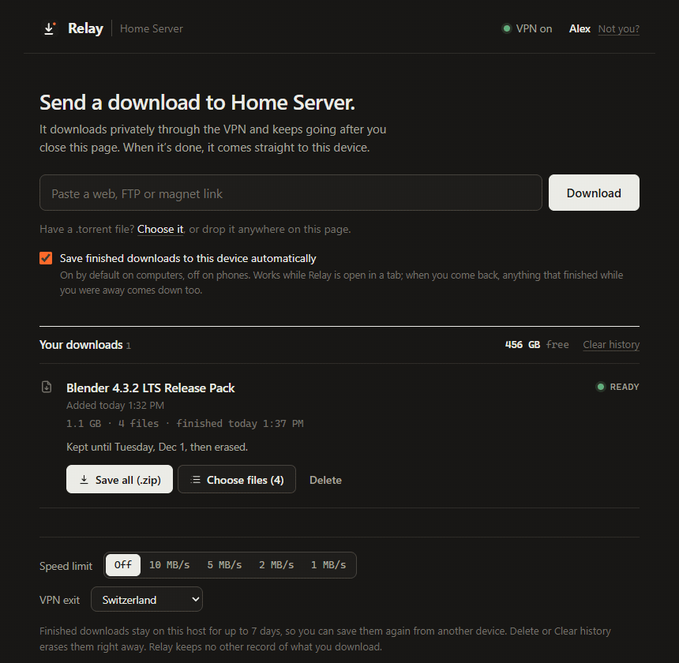
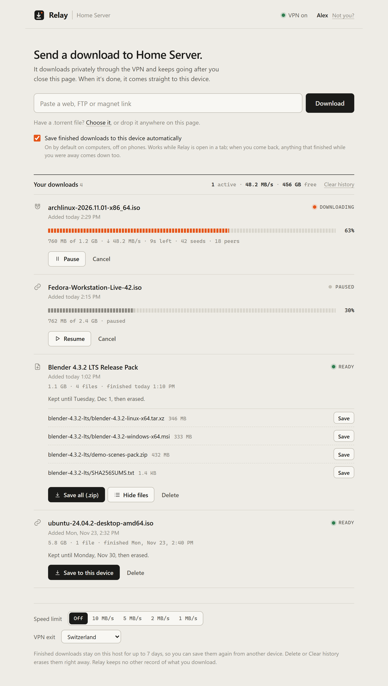
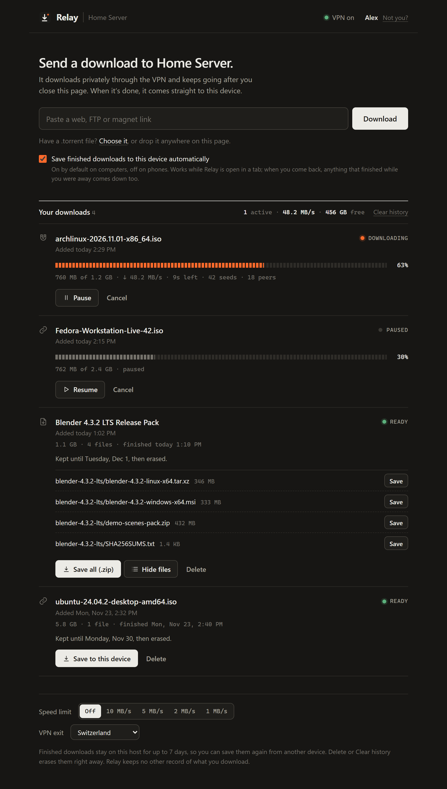
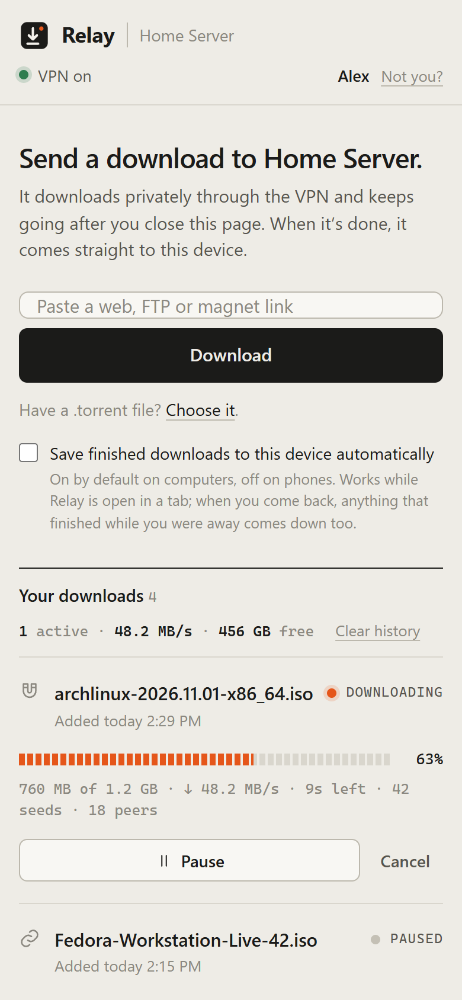
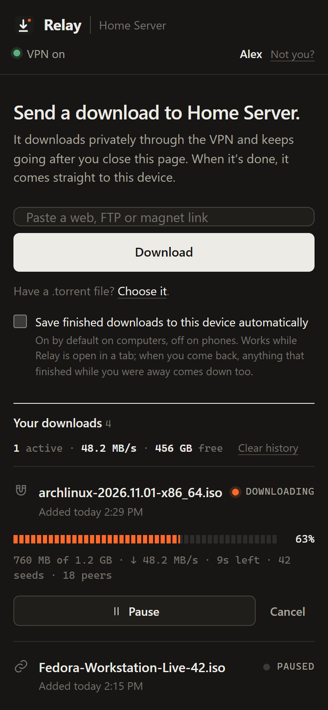

<div align="center">
  
  <h1>Relay</h1>
  <p><strong>A standalone, self-hosted household download appliance powered by <code>aria2</code>, Flask, and Waitress.</strong></p>
  <p>
    
    
    
    
  </p>
</div>

<p align="center">
  <picture>
    <source media="(prefers-color-scheme: dark)" srcset="docs/assets/demo-dark.gif">
    <source media="(prefers-color-scheme: light)" srcset="docs/assets/demo-light.gif">
    
  </picture>
</p>

Open Relay in any browser on your network, enter your name once, and paste a link (HTTP, HTTPS, FTP, magnet, or `.torrent` file). Relay downloads it in the background and delivers finished files straight to your device—single files as-is, multi-file folders as an instant streaming `.zip`.

Built to run anywhere:
- **Standalone app** on Windows, macOS, or Linux (`relay serve` or a compiled single-file executable)
- **Docker / Docker + Gluetun VPN** (`docker compose up -d --build`)
- **Hardened Linux home server** with dedicated system users, `nftables` VPN-only kill-switch, automatic NAT-PMP port forwarding, optional multi-exit WireGuard switcher, and both **systemd** and **OpenRC** service templates
- **Agent-configurable**: includes an [`agents/`](agents/) folder so any AI coding agent (Claude Code, Codex, Antigravity, Cursor, etc.) can inspect your machine and configure Relay for your exact environment.

---

## Screenshots

### Light & Dark Appliance Themes

Relay automatically follows your device's color scheme—warm paper in daylight, warm charcoal at night—with segmented progress meters, live speed/ETA readouts, expandable multi-file drawers, a speed limit switch, and an optional VPN exit switcher.

<table>
  <tr>
    <th align="center">Warm Paper (Light)</th>
    <th align="center">Charcoal (Dark)</th>
  </tr>
  <tr>
    <td valign="top"></td>
    <td valign="top"></td>
  </tr>
</table>

### Mobile Ready

On phones and tablets, auto-save defaults to off (so big files never arrive unasked), controls stack cleanly for thumb reach, and you can kick off a download on your phone and pick it up on your computer later.

<p align="center">
  &nbsp;&nbsp;&nbsp;&nbsp;
  
</p>

---

## Features

- **Clean appliance UI**: Warm light & dark themes, segmented progress meters, live speed/ETA readouts, drag-and-drop `.torrent` uploads, and zero frontend build tooling.
- **Per-device auto-save**: On by default on desktops and off on phones/tablets; each browser remembers its own preference and saves completed downloads automatically once per device.
- **Per-person isolation**: Case-insensitive name labels keep each person's list separate; other users' job IDs return `404`. Optional scrypt-hashed household password (`relay passwd`) with rate limiting and live reload.
- **Zero-log privacy posture**:
  - `aria2c` writes no log files.
  - SQLite runs with `PRAGMA secure_delete = ON` so deleted rows are overwritten in-place.
  - Finished, failed, and cancelled jobs (files, `.torrent` uploads, and DB rows) are erased automatically after `keep_days` (default: 7 days), or immediately via **Delete** / **Clear history**.
  - Private torrents (`7:privatei1e`) never receive public fallback trackers.
- **Network safety built in**:
  - Private/loopback client gatekeeping by default (with explicit opt-in for Tailscale CGNAT, custom subnets, and trusted reverse proxies).
  - DNS-rebinding protection via `Host` header validation.
  - CSRF header enforcement (`X-Relay: 1`) + `SameSite=Strict`, `HttpOnly` session cookies.
  - Local/private URL refusal (SSRF guard) and strict symlink/path-traversal checks.
- **Optional VPN protection**:
  - **Direct mode** (`vpn_mode: "none"`): Standalone out of the box; UI clearly displays `Direct`.
  - **Interface mode** (`vpn_mode: "interface"`): Pauses downloads unless your configured VPN interface (`wg0`, `tun0`, `utun*`, etc.) is up.
  - **External mode** (`vpn_mode: "external"`): Integrates with Docker + Gluetun health checks.
  - **Hardened Linux guard mode** (`engine_mode: "helper"`, `vpn_mode: "guard"`): Dedicated `relaydl` user locked to the VPN interface with `nftables` + optional Proton NAT-PMP port forwarding and live WireGuard exit country switching.

---

## Quick Start (Standalone)

### Prerequisites
- Python 3.10+
- [`aria2`](https://aria2.github.io/) installed on your PATH:
  - **Windows**: `winget install aria2.aria2`
  - **macOS**: `brew install aria2`
  - **Debian / Ubuntu**: `sudo apt install aria2`

### Easy Start (One-Click)

- **Windows**: Double-click [`ezstart.bat`](ezstart.bat)
- **macOS / Linux**: Run `./ezstart.sh`

On first launch, it sets up `.venv`, installs Relay, checks for `aria2c`, starts the server with hardware-tuned settings, and opens your browser to **http://127.0.0.1:8080/**. Double-clicking again while Relay is already running simply opens the page.

### Manual Install and Run

```bash
git clone https://github.com/nowonderwhyy/relay.git
cd relay

python3 -m venv .venv
# Linux / macOS:
source .venv/bin/activate
# Windows (PowerShell):
# .\.venv\Scripts\Activate.ps1

pip install .
relay doctor
relay serve --portable --open
```

Open **http://127.0.0.1:8080/** (or `http://<your-lan-ip>:8080/` from another device on your network).

### Optional Household Password

```bash
relay passwd --portable          # set or change password
relay passwd --portable --clear  # remove password (name-only)
```

---

## Build a Standalone Executable

Compile a self-contained single-file binary (optionally embedding `aria2c` inside it):

```bash
pip install -e ".[build]"
python deploy/build/build_standalone.py --bundle-aria2
```

Run the built binary directly from `dist/relay` (or `dist/relay.exe`):

```bash
./dist/relay serve --portable --open
```

---

## Docker

### Standalone

```bash
docker compose up -d --build
```

### Routed Through a VPN (Gluetun)

Create a `.env` file with your VPN provider settings (see [`agents/profiles/docker-gluetun.md`](agents/profiles/docker-gluetun.md)), then run:

```bash
docker compose -f docker-compose.gluetun.yml up -d --build
```

---

## Hardened Linux Home Server (systemd or OpenRC)

For a dedicated Linux server with a kernel-level `nftables` VPN kill-switch and isolated download user:

```bash
sudo \
  RELAY_STAGING_DIR="/srv/storage/relay-downloads" \
  RELAY_PORT="80" \
  RELAY_HOST_LABEL="Home Server" \
  RELAY_VPN_INTERFACE="wg0" \
  RELAY_WIREGUARD_BACKEND="wg-quick" \
  bash deploy/linux/install.sh
```

See [`agents/profiles/linux-systemd-vpn.md`](agents/profiles/linux-systemd-vpn.md) and [`agents/profiles/linux-openrc-vpn.md`](agents/profiles/linux-openrc-vpn.md) for Proton VPN NAT-PMP port forwarding and multi-location exit switching.

---

## Configure Automatically with an AI Coding Agent

Every environment is different. Point your coding agent (Claude Code, Codex, Antigravity, Cursor, etc.) at this repo and ask:

> "Read `agents/SETUP_WORKFLOW.md` and configure Relay for my machine."

The [`agents/`](agents/) folder includes a zero-dependency environment probe ([`agents/scripts/detect_env.py`](agents/scripts/detect_env.py)), a configuration decision matrix, deployment profiles for every major OS/init/VPN setup, and a full verification checklist.

---

## Configuration Reference

Generate a starter config with `relay init` or copy [`config.example.json`](config.example.json). Settings load in priority order: **defaults -> `config.json` -> `RELAY_*` environment variables -> CLI flags**.

| Key | Env Var | Default | Description |
| --- | --- | --- | --- |
| `instance_name` | `RELAY_INSTANCE_NAME` | `Relay` | App wordmark |
| `host_label` | `RELAY_HOST_LABEL` | machine hostname | Subtitle next to wordmark |
| `host` / `port` | `RELAY_HOST` / `RELAY_PORT` | `0.0.0.0` / `8080` | HTTP bind address and port |
| `staging_dir` | `RELAY_ROOT` | OS user data dir | Active and completed downloads |
| `data_dir` | `RELAY_DATA` | OS user data dir | SQLite ledger and uploaded `.torrent`s |
| `keep_days` | `RELAY_KEEP_DAYS` | `7` | Days before completed/failed jobs are auto-erased |
| `performance_profile` | `RELAY_PROFILE` | `auto` | `auto` (`fast` on >=12 GB RAM & >=6 threads, else `balanced`), `balanced`, or `fast` |
| `engine_mode` | `RELAY_ENGINE_MODE` | `direct` | `direct` (standalone) or `helper` (Linux root helper) |
| `vpn_mode` | `RELAY_VPN_MODE` | `none` | `none`, `interface`, `external`, or `guard` |
| `vpn_interface` | `RELAY_VPN_INTERFACE` | `""` | Tunnel interface (`wg0`, `tun0`, etc.) |
| `vpn_dns` | `RELAY_VPN_DNS` | `""` | Optional tunnel DNS IP for aria2 async DNS |
| `vpn_gateway` | `RELAY_VPN_GATEWAY` | `""` | Optional NAT-PMP gateway IP (e.g. `10.2.0.1`) |
| `allow_cgnat` | `RELAY_ALLOW_CGNAT` | `false` | Allow RFC 6598 (`100.64.0.0/10`, e.g. Tailscale) |
| `allowed_hosts` | `RELAY_ALLOWED_HOSTS` | `[]` | Extra `Host` headers allowed behind a proxy or Tailscale |
| `trusted_proxies` | `RELAY_TRUSTED_PROXIES` | `[]` | Proxy IPs trusted to supply `X-Forwarded-For` |

---

## Development & Tests

```bash
python3 -m unittest discover -s tests -v
```

## License

[MIT](LICENSE)
